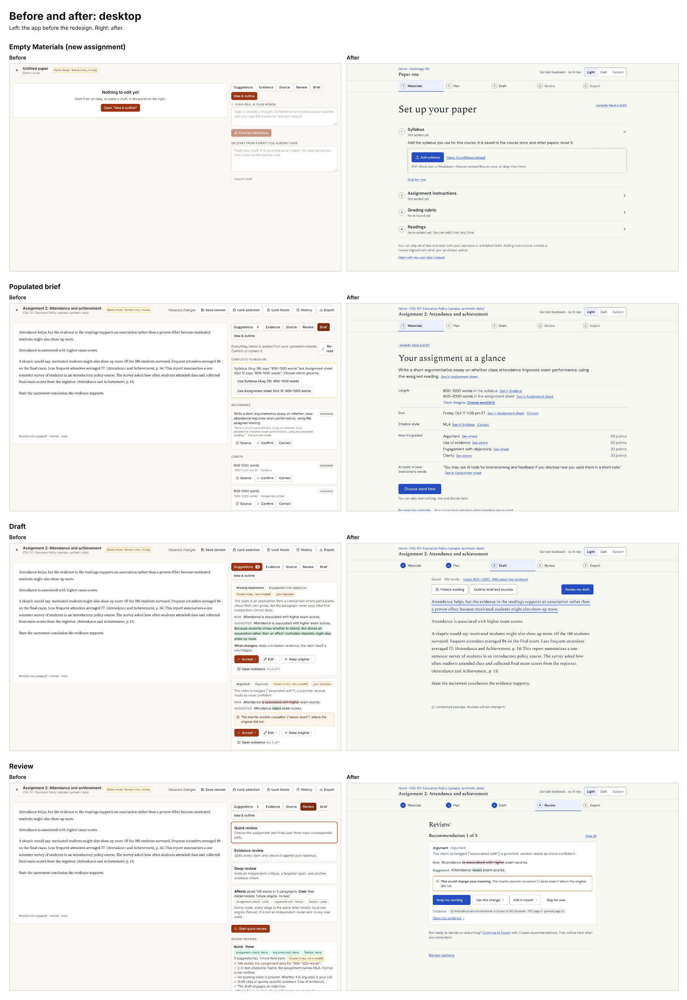
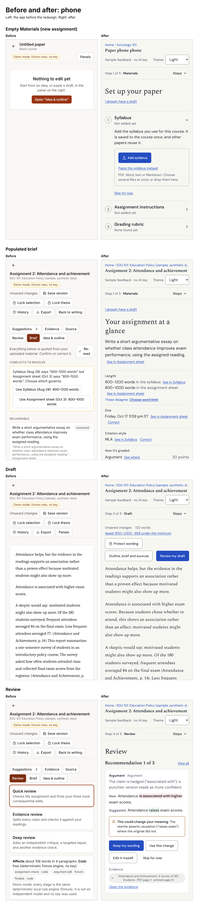

# UX redesign: what changed, what was checked

Source brief: `Writing-Studio-UX-Redesign.md` (read in full). `Writing-Studio-Design-Reference.html` was **not** supplied to this session, only the Markdown, which the brief says is enough. Nothing below claims a pixel match to that file.

## What changed

One assignment page became five stages with their own URLs: `/assignments/:id/materials | plan | draft | review | export`.

| Stage | What it does now |
|---|---|
| Materials | Rows for Syllabus, Assignment instructions, Rubric, Readings. Multi-file intake with a type and a share-scope per file. Paste works as well as upload. A brief with the length, due date, citation style, how it's graded and the AI rule, each linking to the exact quote. One conflict question ("Choose word limit") instead of a list. "I already have a draft" skips planning. |
| Plan | "What do you think?", two directions, an editable thesis, an editable outline with "Source needed" markers. Writing is the default; "Draft from this outline" needs the student to acknowledge the assignment's AI rule first. |
| Draft | A quiet centred column. Autosave, word count, and the word target (which opens where the limit came from). A side panel for Outline, Brief, Sources, History. "Protect wording". Text typed just before leaving is saved; a second tab that saved first is detected and nothing is lost. |
| Review | "Review my draft" (Quick). Real job stages while it runs. One recommendation at a time with the sentence in context, a before/after, a meaning-change warning and an evidence sheet that opens at the quote. Keeping your wording is as easy as using the change. Outcome line: "2 changes applied · 1 kept as written". |
| Export | Exact preview of what will be downloaded. "Download Word document" is primary; plain text and the process report are secondary. The assistance statement is previewed exactly. Hashes are behind "details". |

Also: light by default (even on a dark OS) with Light / Dark / System, DM Sans and Spectral served locally, flat surfaces. The design tokens are in `app/tailwind.config.js` and `app/src/index.css`.

Server changes that make this honest: assignment and rubric files are always scoped to one paper; a sibling assignment's rubric never counts; a word-limit choice is stored and the review uses it; import reports each file as ready / duplicate / needs text / failed; the resume stage is stored apart from completion; Export completes only after a download succeeds.

## Before and after

Individual frames: `before/` (the old app) and `after/` (this build; desktop 1440x900, phone 390x844, plus dark desktop for Materials, Export, Draft, Review).

## Automated checks (commands you can re-run from `app/`)

| Check | Result |
|---|---|
| `npm run typecheck` | clean |
| `npm test` (vitest) | 145 passed, 14 files |
| `npm run test:smoke` (builds, then runs three browser journeys in Chromium against a fresh fixture-mode server) | all passed |
| `node scripts/run-assignment.mjs --mode fixture` (a new assignment, idea to export, through the new stages) | passed, 150-word export, 0 paid calls |
| `node scripts/run-assignment.mjs --mode mock-live` (live code path against a local mock, **not** a provider) | passed |

The journeys assert on rendered UI and downloaded files:

- **materials.mjs.** New assignment: skip the syllabus, paste instructions, the brief appears on the same page with length 700–900 words, due date, APA, three criteria with points, and the AI rule. Attendance sample: both word limits shown, the original opens in a sheet, Escape closes it and focus returns, one click records the choice, it survives a reload, nothing was uploaded.
- **flow.mjs.** Choose the limit → Plan → two directions → thesis → outline → acknowledged generation (button stays disabled until acknowledged) → Draft → type → protect the thesis → autosave → word target opens its source → type and leave at once (text kept) → a second tab saves first (banner, my text kept, "Save my text on top") → Review → recommendations in context → evidence at PDF page 2 / printed page 14 with the exact sentence highlighted → keyboard keep/use decisions → outcome line → brand-new browser profile reopens the same draft and the locked thesis is unchanged → Export preview equals the DOCX and TXT byte for byte (DOCX read back with mammoth), PDF report produced, Export counts as done only after a download, statement preview equals the exported TXT → History reachable and returns to Draft → all five stages at 390px without sideways scroll, the side panel is a bottom sheet.
- **extras.mjs.** A locked stage explains itself and its action goes to Draft. Draft-first: a pasted draft opens untouched with zero model calls. Mixed upload: a readable PDF and a broken one are reported separately, the failed file is replaced in place, no duplicate of the good one. Light on a dark OS first; Dark persists; System follows the OS. Keyboard: skip link works and every tab stop has a visible ring. 320 px and 640 px wide (the 200 % zoom equivalent): Materials, Plan and Draft never scroll sideways, including with an 80-character word.

Bugs these journeys found and I fixed: the evidence sheet lost focus on close; the skip link did not move focus; long unbroken words overflowed at 320 px; History's back link went to the assignment root.

## Observed by eye, not asserted by a test

I looked at the screenshots listed above. Things I judged by looking: spacing, hierarchy, whether the first screen invites one action, dark-mode legibility. A test did not check them; a person should.

## Not done, or not claimed

- No live-provider run (no key here). Everything above is fixture mode, with the live path checked only against a local mock.
- The five-student pilot is **not run**. Plan: `docs/PILOT.md`; for this redesign, watch each student do (1) paste instructions and say what they think the brief means, (2) resolve a length conflict, (3) decide on three recommendations, and record hesitations, wrong clicks and whether they could find "keep my wording".
- Screen-reader output was not listened to. Roles, names and live regions are in place and were checked in the DOM only.
- "Keep my direct tone" (an optional voice preference in Review) is not built.
- The Home and Course pages follow the new tokens but were not redesigned.
- Phone dark-mode screenshots were not captured.
